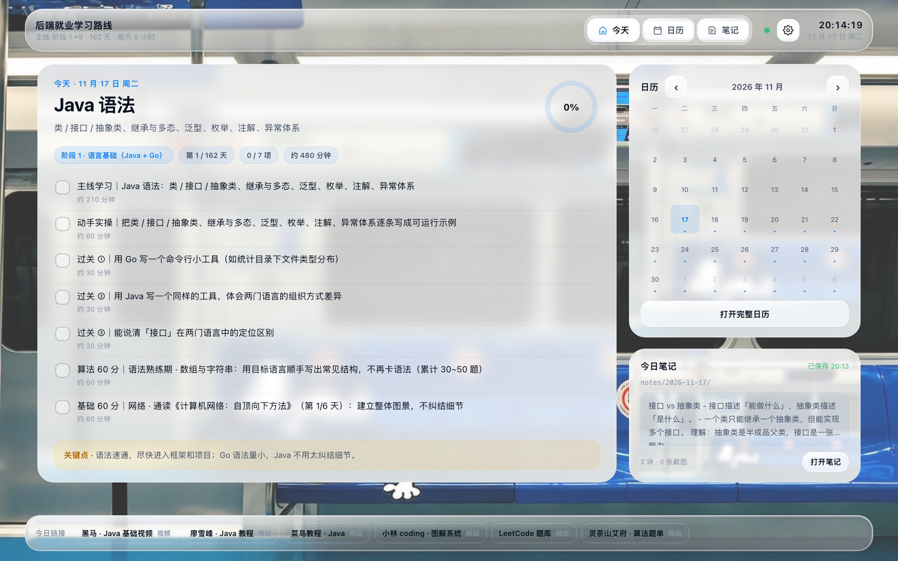

# Backend Career Study Plan · Daily Dashboard

[中文](README.md) · [English](README.en.md)

A **pure front-end, zero-dependency, download-and-run** local study planner. It turns a 162-day backend engineering roadmap into a checklist you open every day: what to study today, how long each block takes, tick things off, jump straight to the day's links, and look back through a calendar.

The original "quick diary" has since been upgraded to **AI screenshot notes**: drag a lecture screenshot in, click **Save**, and the AI reads the image, reorganizes the key points, and writes the shortest useful annotation and explanation — stored as Markdown, one folder per day.



---

## 1. Getting Started

### Just want the plan and checkboxes

1. Download or clone this repository.
2. **Double-click `index.html`** to open it in a browser.

The dashboard needs no Node, no npm, and no server. Over `file://`, checkboxes and the calendar work normally (state lives in browser localStorage).

Recommended browsers: Chrome / Edge (the liquid-glass refraction only runs on Chromium). Safari 15+ and Firefox work too, but the glass falls back to plain translucency.

### Want the AI screenshot notes

1. Double-click `启动.command` (the launcher). It starts a local server and opens `http://127.0.0.1:5271`.
2. Click the gear icon, paste your DeepSeek API key, click **Test connection**, then **Save**.
3. Switch to the **Notes** tab, drag your screenshot in, and click **Save**.

Get a key at <https://platform.deepseek.com/api_keys>. It is written only to `config.local.json` on your machine (mode 0600) and is never uploaded anywhere.

On macOS, if `启动.command` is blocked the first time, right-click it and choose **Open**.

---

## 2. What It Does

### 1. Today's checklist

- 7 tasks per day, **480 minutes (8 hours)** in total.
- Each task shows an estimated duration; the ring in the corner shows today's completion percentage.
- Ticking a task saves immediately and survives a browser restart.
- A toast appears when everything is done.

### 2. How a day is built

| Block | Time | Description |
| --- | --- | --- |
| Main study | 210 min | The day's core material |
| Hands-on | 60 min | Turn the concept into a runnable example |
| Checkpoint ① | 30 min | First acceptance criterion of the stage |
| Checkpoint ② | 30 min | Second acceptance criterion |
| Checkpoint ③ | 30 min | Third acceptance criterion |
| Algorithms | 60 min | Syntax fluency → topic drills → Hot 100 → high-frequency sprint |
| CS basics / interview prep / AI | 60 min | Three parallel tracks rotating by day |

The three checkpoints come from the **acceptance criteria** at the end of each stage in the source document. The main study block exists to make those three boxes tickable.

### 3. Calendar

- Month view, one cell per day; colored dots mark all done / in progress / planned / free.
- Click any day to see what to study, how many tasks, and how long each takes.
- Tick that day's tasks directly, or jump to that day's notes.

### 4. AI screenshot notes (new)

- One folder per day: `notes/2026-11-17/笔记.md` plus `images/`.
- Drag screenshots anywhere onto the Notes page; they land in the pending area, and **Save** calls the AI immediately.
- Each save appends one `## HH:mm · 截图笔记` block — **earlier content is never touched**.
- The chat box only rewrites the most recently saved block. Quick actions: **Shorter**, **Rephrase**, **Highlight**.
- Screenshots and notes stay local; images are sent to DeepSeek only when you click Save.

### 5. "Today's links" footer

A fixed row with the day's main video and study-site homepages, opening in new tabs. Swapping in your own sites is easy (see below).

### 6. Other details

- The clock in the header is live and rolls over to the new day automatically.
- Multiple tabs stay in sync for task checkboxes (localStorage).
- Generous whitespace plus liquid-glass navigation.
- A slim scrollbar appears on the right only while scrolling, then fades out.
- The footer is hidden on the Notes page so it never covers a long note.

---

## 3. How to Take Notes

- **Drag and drop**: drag screenshots anywhere on the Notes page. A full-page overlay says "Drop, and the screenshot comes in"; release to add. You can also paste with `⌘V` or click **Choose screenshots**. Up to 10 images at a time.
- **Thumbnails**: shown two per row with the full screenshot; click to enlarge, click × to remove.
- **Compression**: images are resized in the browser to a 1400 px longest edge as PNG before upload, saving bandwidth and tokens.
- **Save**: images are written to disk first → the AI follows `agent/笔记生成.md` → the result is appended to `笔记.md`. If anything fails, the images just saved are removed, so no orphan files are left.
- **Only the last block moves**: every save creates a `## HH:mm · 截图笔记` block, and chat edits replace only the final block. The server guarantees earlier blocks are never rewritten.
- **Chat can see the image**: when editing the last block, its referenced screenshots are sent to the model again, so it can revise while looking at the image.

---

## 4. Project Layout

```
Java学习计划/
├── index.html            Page shell (Today / Calendar / Notes)
├── style.css             All styles (glass, cards, calendar, notes, responsive)
├── app.js                Dashboard + Notes logic (render, checkboxes, drag, save, chat)
├── markdown.js           Markdown renderer for notes (escaping, code, tables, highlights)
├── plan.js               ★ Plan data (162 days, 7 tasks per day)
├── hyalite.js            Liquid-glass refraction library (MIT, see below)
├── server.js             Local server (zero-dependency; serves pages + notes API)
├── lib/
│   ├── deepseek.js       DeepSeek client (supports image input)
│   ├── notes-store.js    Markdown / screenshot storage
│   └── prompts.js        Prompt assembly
├── agent/
│   ├── 笔记生成.md        "Screenshot → note" rules, editable
│   └── 笔记修改.md        "Edit the last block" rules
├── test/                 node:test suite, no real API key needed
├── 启动.command           Double-click launcher for the local server + browser
├── wallpaper.png         Background wallpaper (original)
├── wallpaper-blur.jpg    Pre-baked blurred wallpaper used behind glass cards
├── preview.png           Interface screenshot
├── notes/                One folder per day (not committed; generated at runtime)
├── config.local.json     Your DeepSeek key (not committed; mode 0600)
└── README.md
```

The dashboard does not use the network at runtime; checkboxes live in browser localStorage (key `javaplan.tasks.v1`). The notes feature needs the local server, and notes are plain Markdown under `notes/` — easy to back up or sync as a folder.

---

## 5. Making It Your Own

### Change daily tasks / durations

Open `plan.js`:

```js
const PLAN = {
  start: '2026-11-17',
  title: '后端就业学习路线',
  subtitle: '主线 阶段 1→9 · 162 天 · 每天 8 小时',
  days: {
    '2026-11-17': {
      n: 1,                    // day number
      stage: '阶段 1 · 语言基础（Java + Go）',
      topic: 'Java 语法',
      focus: 'One-line summary for the day',
      tasks: [ { t: 'Task text', m: 210 }, ... ],
      links: [ { name: 'Link name', url: 'https://...' } ],
      tip: 'A reminder for the day'
    },
    ...
  }
};
```

- Add a day: copy a date object, change the key and `n`.
- Change a duration: edit `tasks[].m`; the "about N minutes" labels recalculate automatically.
- Change the task count: add or remove entries in `tasks`; the progress ring and counters adapt.

### Change the study sites in the footer

`renderDock()` in `app.js` reads the video link from `PLAN.days[today].links` and appends the `STUDY_SITES` array at the top of `plan.js`. Replace `STUDY_SITES` with your own sites.

### Change the wallpaper

- Replace `wallpaper.png` (16:9 recommended).
- Regenerate `wallpaper-blur.jpg` by downscaling the new wallpaper and applying a Gaussian blur (any online tool or Python/PIL works). It sits behind glass cards, so it can be quite blurry.

### Change the AI's writing style

`agent/笔记生成.md` and `agent/笔记修改.md` are the prompts. No restart needed — the next request reads them again.

---

## 6. Implementation Notes

- **No framework, no build for the dashboard**: plain DOM plus event delegation; `app.js` is one IIFE. Edit and refresh.
- **Zero-dependency notes server**: only Node's built-in `http`, `fs`, and `fetch`; no `npm install`.
- **View caching**: the three main views cache their DOM by version (`state.ver` / `state.viewVer`). Switching tabs with unchanged data only toggles `display` instead of rebuilding nodes.
- **Performance choices**:
  - The header and footer use `hyalite.js` for real refraction; they sit over a static wallpaper, so it is computed once.
  - Cards skip runtime filters and use a **pre-baked blurred wallpaper** as their background — zero repaint, zero filter while scrolling.
  - Buttons, pills, and checkboxes use translucency and borders only.
- **Local storage**: `loadLS/saveLS` wrap `try/catch`, so private mode does not throw.
- **Responsive**: breakpoints at 1240 px / 1080 px / 720 px; narrow screens collapse to one column.
- **Notes security**: the server listens on `127.0.0.1` only, accepts only local Host and same-origin requests, validates image magic bytes, and its static allowlist never exposes `config.local.json`.

---

## 7. Commands

```bash
npm start          # start the server (same as node server.js)
npm test           # run tests (no real API key needed)

# different port
JAVA_NOTES_PORT=6000 npm start

# mock mode: no DeepSeek call, fixed text, useful while restyling
JAVA_NOTES_MOCK=1 npm start

# keep notes elsewhere (e.g. for testing)
JAVA_NOTES_ROOT=/path/to/notes npm start

# provide the key via env (takes precedence over config.local.json)
DEEPSEEK_API_KEY=sk-... npm start
```

---

## 8. Privacy

- `notes/`, `config.local.json`, and `*.log` are gitignored and never committed.
- The API key lives only in the local `config.local.json`, mode 0600.
- Images stay in browser memory until you click Save; only then are they sent to DeepSeek.
- The server binds to `127.0.0.1`, so other devices on your LAN cannot reach it.

---

## 9. Third-Party

- [hyalite · liquid glass](https://github.com/VII-Cae/hyalite--liquid-glass) — MIT License, used for the liquid-glass refraction in the header and footer.
