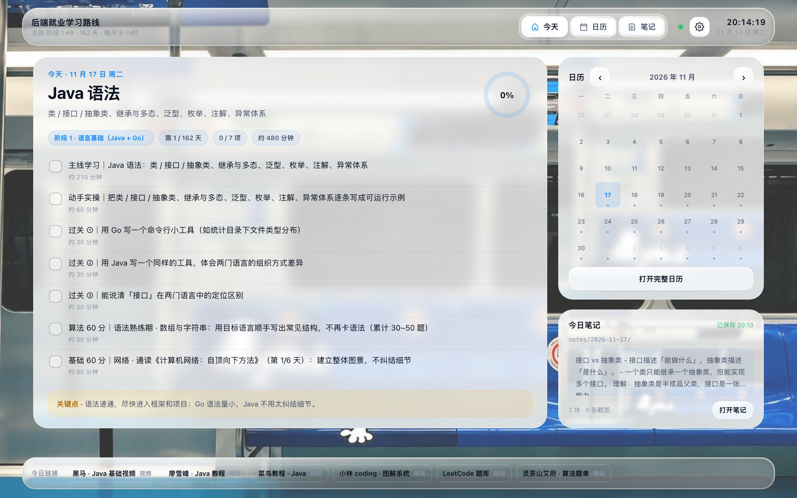

# 后端就业学习路线 · 每日学习看板

[中文](README.md) · [English](README.en.md)

一个**纯前端、零依赖、下载即用**的本地学习计划看板。把 162 天的后端学习路线做成每天打开就能看的清单：今天学什么、每条要花多久、学完勾掉、当天链接一键直达、日历回看。

后来把原来的「随手写日记」升级成了「截图 AI 笔记」：课堂截图拖进来，点一次「手动保存」，AI 识图后把知识点重新排好，用最少的字写注释和理解，按天存成 Markdown。



---

## 一、直接使用

### 只看计划、勾任务

1. 下载或克隆本仓库
2. **双击 `index.html`**，用浏览器打开即可

看板部分不需要 Node、不需要 npm、不需要起服务器，`file://` 协议下勾选和日历都正常（存在浏览器 localStorage 里）。

推荐浏览器：Chrome / Edge（液态玻璃折射效果只在 Chromium 内核生效），Safari 15+、Firefox 可正常使用但玻璃会退化为普通半透明。

### 要用截图 AI 笔记

1. 双击 `启动.command`，会起一个本地服务并打开 `http://127.0.0.1:5271`
2. 点右上角齿轮，填 DeepSeek API Key，点「测试连接」，成功后「保存」
3. 切到「笔记」页，把截图拖进来，点「手动保存」

Key 在 <https://platform.deepseek.com/api_keys> 申请，只写进本机的 `config.local.json`（权限 0600），不会上传到任何地方。

如果 macOS 第一次拦住 `启动.command`，右键它 → 打开。

---

## 二、它有什么

### 1. 今日清单

- 每天 7 条任务，合计 **480 分钟（8 小时）**
- 每条任务带预估分钟数，右上角环形进度显示当天完成百分比
- 勾掉任务即时保存，关掉浏览器再打开还在
- 全部勾完会弹一条提示

### 2. 每天的任务构成

| 板块 | 时长 | 说明 |
| --- | --- | --- |
| 主线学习 | 210 min | 当天知识点的原文学习内容 |
| 动手实操 | 60 min | 把知识点写成可运行示例 |
| 过关 ① | 30 min | 文档里该阶段的第一条过关标准 |
| 过关 ② | 30 min | 第二条过关标准 |
| 过关 ③ | 30 min | 第三条过关标准 |
| 算法 | 60 min | 按「语法熟练 → 专题突破 → Hot100 → 高频冲刺」推进 |
| 计算机基础 / 八股 / AI | 60 min | 三条并行线按天轮转 |

「过关三条」来自原文档每个阶段末尾的**过关标准**，学完当天主线就是为了把这三条打勾。

### 3. 日历

- 月视图，一格一天，颜色点区分：全部完成 / 进行中 / 有计划 / 自由安排
- 点任意一天，右侧显示那天学什么、几条任务、各自多长
- 可以在日历里直接勾选那天的任务、跳去看那天的笔记

### 4. 截图 AI 笔记（新）

- 每天一个文件夹：`notes/2026-11-17/笔记.md` + `images/`
- 截图拖到笔记页任意位置，松手就加进待保存区，点「手动保存」马上调 AI
- 每次保存只追加一块 `## HH:mm · 截图笔记`，**前面的内容一个字不动**
- 右侧聊天框只改最新保存的那一块，快捷语句：`更简短`、`换一句`、`高亮语句`
- 每块右上角有「编辑」，可以直接改这一块的 Markdown，保存只替换这一块，别的块不动
- 截图、笔记都在本机，只有点保存时才会把图发给 DeepSeek

### 5. 底栏「今日链接」

固定一行：当天的主线视频 + 学习网站首页，点开新标签直达。换成你自己常用的站点也很简单（见下）。

### 6. 其他细节

- 顶栏时间是实时的，跨天会自动切到新一天
- 多个标签页同时打开时，任务勾选会互相同步（localStorage）
- 一整页白噪音极少的留白布局 + 液态玻璃导航
- 滚动时右侧才出现的细滚动条，停手自动淡出
- 笔记页隐藏底部网站栏，避免挡住长笔记

---

## 三、记笔记怎么用

- **拖拽**：把截图拖到笔记页任意位置，整页会浮出「松手，截图就加进来」，松手即加入；也可以 `⌘V` 粘贴，或点「选择截图」。一次最多 10 张。
- **缩略图**：两列完整显示，点开看大图，点右上角 × 移除。
- **压缩**：截图先在浏览器里压到最长边 1400px 的 PNG，再上传，省流量也省 token。
- **保存**：截图先落盘 → AI 按 `agent/笔记生成.md` 的规则整理 → 追加到 `笔记.md`。中途失败会把这次刚存的图删掉，不留孤儿截图。
- **AI 只动最后一块**：每次保存生成一个 `## HH:mm · 截图笔记` 块；聊天修改只替换最后一个块。手动点「编辑」可以改任意一块，但只替换你选中的那一块。
- **聊天看图**：改最后一块时，会把它引用的截图重新发给模型，所以它能看着图改。

---

## 四、文件结构

```
Java学习计划/
├── index.html            页面骨架（三个视图：今天 / 日历 / 笔记）
├── style.css             全部样式（玻璃、卡片、日历、笔记、响应式）
├── app.js                看板 + 笔记页逻辑（渲染、勾选、拖拽、保存、聊天）
├── markdown.js           笔记的 Markdown 渲染（转义、代码块、表格、高亮）
├── plan.js               ★ 计划数据（162 天，每天 7 条任务）
├── hyalite.js            液态玻璃折射库（MIT，见文末）
├── server.js             本地服务（零依赖，托管页面 + 笔记 API）
├── lib/
│   ├── deepseek.js       DeepSeek 客户端（支持图片输入）
│   ├── notes-store.js    笔记 md / 截图的读写
│   └── prompts.js        提示词装配
├── agent/
│   ├── 笔记生成.md        「截图 → 笔记」的规则，可以直接改
│   └── 笔记修改.md        「改最后一块」的规则
├── test/                 node:test 测试，不需要真 Key
├── 启动.command           双击启动本地服务并打开浏览器
├── wallpaper.png         背景壁纸（原图）
├── wallpaper-blur.jpg    预烘焙的模糊壁纸，给卡片当玻璃背景用
├── preview.png           界面截图
├── notes/                每天一个文件夹（不提交，自动生成）
├── config.local.json     你的 DeepSeek Key（不提交，权限 0600）
├── README.md             中文说明
└── README.en.md          English README
```

看板部分运行时不联网，任务勾选只写在浏览器 localStorage（键名 `javaplan.tasks.v1`）。笔记功能需要本地服务，笔记内容存在 `notes/` 里，是纯 Markdown，随时可以整个文件夹备份或同步。

---

## 五、想改成自己的计划

### 改每天的任务 / 时长

打开 `plan.js`，结构是：

```js
const PLAN = {
  start: '2026-11-17',
  title: '后端就业学习路线',
  subtitle: '主线 阶段 1→9 · 162 天 · 每天 8 小时',
  days: {
    '2026-11-17': {
      n: 1,                    // 第几天
      stage: '阶段 1 · 语言基础（Java + Go）',
      topic: 'Java 语法',
      focus: '当天的一句话概要',
      tasks: [ { t: '任务文案', m: 210 }, ... ],
      links: [ { name: '链接名', url: 'https://...' } ],
      tip: '当天的一句提醒'
    },
    ...
  }
};
```

- 想加一天：复制一段日期对象，改键名和 `n` 即可
- 想改时长：改 `tasks[].m`，页面上的「约 N 分钟」会自动重算
- 想改任务条数：`tasks` 数组随意增删，进度环和计数都会自适应

### 换底栏的学习网站

`app.js` 里的 `renderDock()` 会读取 `PLAN.days[今天].links` 里的视频，再加上 `plan.js` 顶部的 `STUDY_SITES` 数组。把 `STUDY_SITES` 改成你自己的常用站点即可。

### 换背景

- 替换 `wallpaper.png`（建议 16:9）
- 重新生成 `wallpaper-blur.jpg`：把新壁纸缩小后做高斯模糊再导出即可（任何一个在线工具或 Python/PIL 都行），它是给卡片当玻璃底用的，所以糊一点没关系

### 改 AI 的写法

`agent/笔记生成.md` 和 `agent/笔记修改.md` 就是提示词。改完不用重启服务，下一次请求会重新读。

---

## 六、实现说明（给想改代码的人）

- **看板无框架、无构建**：原生 DOM + 事件委托，`app.js` 一个 IIFE 跑完，改完刷新就生效
- **笔记服务零依赖**：只用 Node 原生 http / fs / fetch，不需要 `npm install`
- **视图缓存**：三个大视图按版本号缓存 DOM（`state.ver` / `state.viewVer`），数据不变时切 tab 只切 `display`，不重建节点
- **性能取舍**：
  - 顶栏 / 底栏用 `hyalite.js` 做真实折射（它们背后是静止壁纸，只算一次）
  - 卡片不用运行时滤镜，改用**预烘焙的模糊壁纸**当背景 —— 滚动时零重绘、零滤镜
  - 按钮 / 胶囊 / 勾选框只用半透明 + 描边，不叠加滤镜
- **本地存储**：`loadLS/saveLS` 包了 try/catch，隐私模式下不会报错
- **响应式**：1240px / 1080px / 720px 断点，窄屏自动单列
- **笔记安全**：服务只监听 `127.0.0.1`，只放行本机 Host 和同源请求；图片校验 magic bytes；静态白名单不暴露 `config.local.json`

---

## 七、常用命令

```bash
npm start          # 启动服务（等价于 node server.js）
npm test           # 跑测试（不需要真 Key）

# 换端口
JAVA_NOTES_PORT=6000 npm start

# 模拟模式：不调用 DeepSeek，用固定文本走通流程，适合改样式时用
JAVA_NOTES_MOCK=1 npm start

# 临时把笔记放到别的地方（比如测试）
JAVA_NOTES_ROOT=/path/to/notes npm start

# 用环境变量提供 Key（优先级高于 config.local.json）
DEEPSEEK_API_KEY=sk-... npm start
```

---

## 八、隐私

- `notes/`、`config.local.json`、`*.log` 都在 `.gitignore` 里，不会提交
- API Key 只存本机 `config.local.json`，权限 0600
- 不保存截图时，图片只在浏览器内存里；点「手动保存」才会发给 DeepSeek
- 服务只绑定 `127.0.0.1`，局域网内其他设备访问不到

---

## 九、第三方

- [hyalite · liquid glass](https://github.com/VII-Cae/hyalite--liquid-glass) —— MIT License，用于顶栏与底栏的液态玻璃折射效果
